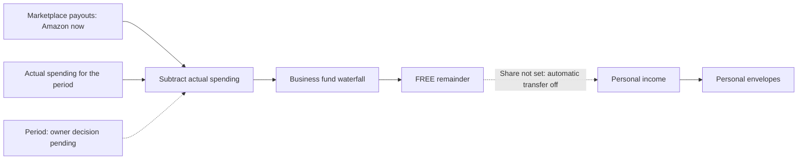

# Treasury — Financial Plan and Personal Finance

## Current owner decision — 2026-10-27, 11:23 ET

Vladimir's decision in Telegram topic 728 supersedes the earlier proposal to
feed Financial Plan with a temporary gross margin and later an Economics
adapter. Treasury is division 3: Financial Plan, Personal Finance, Economics
and Sales overview.

The intended Financial Plan calculation is:

`money to distribute = marketplace payouts − actual spending for the period`

The remainder goes through the business fund waterfall. The currently approved
income source is Amazon; website, TikTok and eBay are later income sources.
These sources represent receipts, analogous to income sources in a tax return.
Unit economics does **not** enter this calculation.

The calculation period is **open**: the owner has not chosen the previous or
following week. Do not choose the period or implement a replacement expense
calculation until a new owner instruction. Economics is deferred as separate
work; its SKU profitability, COGS and Product Truth integration are untouched.

The share of FREE sent to Personal Finance is deliberately **not set**. This is
an owner decision to defer the percentage, not a missing answer to chase.
Automatic personal transfers remain off. Do not assign zero or another default.

This diagram records the owner's direction, **not a claim that the new
period-based spending calculation is deployed**. Do not expand Treasury further
until the owner gives a new instruction.

## What is already deployed

The previous implementation reached production before this correction. It is
retained with an explicit UI notice: **“Temporary calculation — scheme not
approved.”** Its existing calculations and ledger behavior are described here
so they cannot be mistaken for the newly approved direction.

- `/finance` currently uses a percentage reserve. With the existing setting
  `finance:reserve:manualPct = 0.5`, the compatibility resolver returns
  `grossMargin = 1 − reserve = 0.5`. This 50% is a legacy configuration value,
  **not an approved margin assumption**, measured profit or actual spending.
- The current formula is `reserve = round(payout × (1 − grossMargin.rate), 2)`;
  `distributable = payout − reserve`. The existing waterfall allocates FP1,
  then FP2, then FREE. The actual-spending replacement has not been implemented.
- The gross-margin editor and API contract are already published. The notice
  replaces the earlier misleading “until Economics” label; Economics is not
  the planned source for this Financial Plan calculation.
- The personal income bridge is deployed, but `personalShare = null`, so it
  makes no automatic FREE draw. If explicitly configured by the owner later,
  the existing code applies the share to **new FREE after business funds**;
  old FREE is only available through an explicit manual draw.
- Personal Finance includes the obligations registry, status badges, net worth,
  avalanche/snowball payoff plan and 60-day calendar. Court cases, arrears,
  collections and tax windows appear above both payoff strategies. BJ's full
  $6,715.07 commitment replaces its $225 minimum for the first model month;
  missing minimums, rates and court amounts remain explicit.
- Personal routes and records in shared Finance APIs require the current owner
  role. Business Finance access remains available to authorized staff.

These are planning ledger entries. The application does not send bank payments.
This correction changes documentation and UI wording only: it does not set a
personal percentage, change stored reserve settings, distribute income or
replace the business calculation.

## Deployed contract and safeguards (temporary)

`Setting["finance:treasury"]`, when saved, stores `grossMargin`, `personalShare`
and `updatedAt`. Rates use 0–1; `null` means not set, distinct from zero.
When this setting is absent, the resolver reads the older reserve percentage.
The October 27 production read found no new Treasury setting and a 50% legacy
reserve. The legacy value has no date; the UI does not invent one.

The existing type accepts `grossMargin.source = constant | economics` for
compatibility with the published code. This enum is **not approval to build an
Economics adapter**. The unconnected `economics` source resolves to an unavailable
rate and blocks distribution rather than using a constant under a false source.

A committed distribution atomically claims its payouts, records the plan,
credits business funds and, only when configured, debits FREE and creates one
personal income entry. The income is deduplicated by the run ID. A failure rolls
back both pools. Manual FREE draws also use a request ID, check the available
balance and cannot debit twice on replay. Paired ledger entries cannot be
edited independently. Personal income is distributed with reserve zero.

SQLite writers acquire a reservation before reading balances. Concurrent
writers cannot both claim the same income; conflicts stop safely. Owner-only
checks cover settings writes, distribution and personal income. Shared Finance
handlers also check personal scopes and record IDs against the current database
role. Generic transfers cannot cross pools. The cron schedule is unchanged;
automatic personal draws remain off while the share is not set.

Relevant implementation:

- `ss-control-center/src/lib/finance/treasury.ts`, `treasury-config.ts`,
  `reserve-rate.ts`: deployed temporary settings and compatibility resolver.
- `run.ts`, `personal-income.ts`: distribution, manual draws and atomic ledger.
- `/api/finance/config`, `/api/finance/run`, `/api/personal/income`; UI `/finance`
  and `/personal`. No additional pool or duplicated business debt was created.
- `scripts/check-treasury.ts`, `check-personal-access.ts` and
  `check-personal-finance.ts`: transaction, access and calculation checks.

## Work boundaries

1. Completed: Personal Finance screens, access checks and the published
   temporary Treasury implementation described above.
2. This correction: mark the percentage formula unapproved, retain the
   intentionally unset personal share, and record the actual-spending direction.
3. On hold: period selection, implementing payouts minus actual spending,
   assigning a personal share, and any further Treasury development.
4. Deferred separately: Economics. It is not a Financial Plan input.

## Connected modules

- [Economics / Profit engine](economics-profit-engine.md) — separate, deferred.
- [Finance Core — Funds](finance-funds.md) — existing implementation and history.
- [Personal Finance](../../ss-control-center/docs/wiki/personal-finance.md).
- [Sidebar orgboard](sidebar-orgboard.md) — division 3, Treasury.
- [Personal Finance production acceptance](personal-finance-codex-acceptance-2026-10-27.md).

Jackie's reference copy is `wiki/finance/treasury-module-architecture.md` on the
server. This repository document distinguishes the current owner decision from
the temporary code already deployed.

## Production acceptance — 2026-10-27

Vercel deployment `dpl_AHyjYiq6iARFpWNyumgar67z3y9W` is **Ready** and serves
[salutemsolutions.info/finance](https://salutemsolutions.info/finance).
The production build completed on October 27 at 15:32 UTC.

- TypeScript and ESLint passed. Finance core/accrual, personal calculations,
  disposable SQLite Treasury transactions and 109 access/invalid-input checks
  passed. Concurrency checks use two independent database connections; one
  writer completes, a conflicting request stops safely, and replay does not
  create another distribution or income entry.
- 37 production checks passed: protected APIs reject anonymous callers, owner
  reads succeed (including shared personal-scope endpoints and fund details),
  pages redirect anonymous callers to login, and business/personal previews
  write nothing. Temporary margin is 50%; personal share is not set.
- Authenticated Chrome: the margin/share editor loads, unsaved changes disable
  Preview, empty-pool Commit is disabled, and the FREE bridge appears in Personal
  Finance. Temporary test input was discarded without saving settings. Both
  screens and navigation were checked again after the access fix was deployed.
- The payoff screen displays urgent cases before strategy controls. With the
  existing 28-debt selection, November requires $9,237.73 in known minimums and
  dated commitments; $2,750 yields a $6,487.73 shortfall. A $10,000 Snowball
  scenario funds BJ's full statement in November. The original $2,750/Avalanche
  scenario was restored. Thirteen missing minimums remain explicitly unknown.
- Complete `Fund`, `FundEntry`, `Payout`, `FinancePlanRun` and relevant settings
  snapshots match before/after verification. No production distribution,
  personal income, bank payment, migration or reseeding was performed.
- Evidence is outside git in `~/.cache/sscc/audits/treasury-20261027/` with private
  file permissions. Wiki-Brain reports pre-existing unrelated link/memory
  issues. Agent doctor reports the existing four worktrees; its prune dry-run
  retains all auxiliary checkouts. This task created no worktree.

The checks above verify the deployed implementation, not approval of its 50%
assumption. The later owner decision deliberately leaves the personal share
unset and defers Economics; no percentage is being requested.
