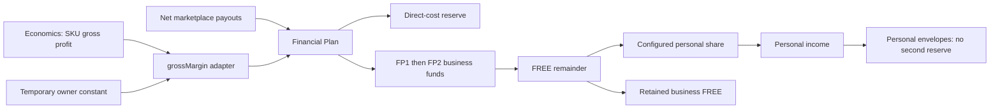

# Treasury — Financial Plan and Personal Finance

Owner scope: Vladimir, Telegram topic 728, 2026-10-27. Treasury is division 3:
Financial Plan, Personal Finance, Economics and Sales overview. The current work
completes financial planning; connecting unit economics is a separate phase.

## Money flow



Economics calculates `grossProfit = price + shipping charged − COGS − packaging
− referral − own shipping`. Its native margin is `grossProfit / revenue`.
Financial Plan receives **net cash payouts**, already reduced by marketplace
fees and marketplace-paid labels. These are different denominators: a future
Economics adapter must reconcile the period, cash basis and costs already
withheld before supplying the Treasury rate. Do not apply a revenue-based SKU
margin directly to net payouts or deduct shipping/referral twice.

For phase 1, `grossMargin.rate` is explicitly the temporary distributable share
of **net payout**, after the restock reserve for COGS + packaging:

- `reserve = round(payout × (1 − grossMargin.rate), 2)`.
- `distributable = payout − reserve`.
- Existing priority waterfall funds FP1, then FP2, respecting absolute amounts,
  percentage allocations, caps and available cash.
- `newFREE` is what remains **after** business funds.
- `personalIncome = round(newFREE × personalShare, 2)`, capped by positive FREE
  balance after this allocation. A pre-existing negative FREE is covered first.
- `retainedNewFREE = newFREE − personalIncome`.

The share is taken from **new FREE**, not the entire distributable pool and not
from the old FREE balance. That preserves business obligations and prevents
repeatedly transferring the same accumulated balance. Historical FREE can be
drawn manually by the owner with an explicit amount and sufficient balance.

These are planning ledger entries; the application does not send bank payments.

## Phase 1 — implemented

One setting, `Setting["finance:treasury"]`, stores:

```json
{
  "grossMargin": { "source": "constant", "rate": null },
  "personalShare": null,
  "updatedAt": "server timestamp on save"
}
```

Rates use 0–1; the UI displays 0–100%. `null` means **not set**, while zero is a
valid explicit setting. The `/finance` editor labels the margin “temporary,
until Economics” and states that a configured personal share applies to manual
and scheduled distributions. Save settings, Preview, then Commit.

Compatibility: when the new setting is absent, the resolver reads the existing
`finance:reserve:manualPct` and returns `grossMargin.rate = 1 − reserve`. The
read-only production check on October 27 found reserve **50%**, therefore the
compatible temporary margin is **50%**. This is the existing owner planning
assumption, not a measured Economics result. No fabricated 58% default is used.
The legacy setting has no timestamp; the UI does not invent one. Once saved,
all callers use the single new setting; legacy API `manualPct` writes are
translated into that same setting rather than creating a competing value.

The personal share was absent at acceptance and remains “not set” until the
owner supplies it. No automatic draw is made while it is absent. No schema
migration or reseeding is necessary.

`runDistribution` commits the payout claim, `FinancePlanRun`, business fund
credits, FREE debit and one `Payout(scope="personal")` in a single transaction.
The personal payout is deduplicated by `treasury:<runId>`; claimed business
payouts cannot be allocated again. Run notes snapshot margin provenance, share,
amounts and input payout IDs. A failed personal write rolls back the business
side too. The personal waterfall consumes that income with reserve zero.

Manual draws also debit FREE and create personal income in one transaction.
Their request ID supports retry without double debit; different payloads cannot
reuse the ID. A paired owner-draw ledger entry cannot be edited, deleted, moved
or unpaid independently. A future reversal must undo both sides together.

Owner-only checks protect settings changes, distribution requests and personal
income handlers. Configuration reads require Finance access. The existing cron
requires its secret and remains unchanged in schedule. No personal percentage
is silently enabled by deployment.

## Phase 2 — separate work

`grossMargin.source` accepts the contract `constant | economics`.
`economics` currently resolves to an unavailable rate and blocks distribution;
it never silently reuses the constant as though Economics supplied it. The UI
cannot enable an unconnected source.

The later adapter must produce a dated, sourced, cash-basis `GrossMargin`
(`rate`, `source`, `basis="net_payout"`, `temporary`, `provenance`, `asOf`) from
adequately covered Economics evidence. The waterfall, FREE bridge and personal
income model do not change. Coverage, period weighting and settlement
reconciliation belong to that later adapter. `/economics`, Product Truth,
SKU costs and Sales overview are not modified in phase 1.

## Personal planning continuation

[Personal Finance](../../ss-control-center/docs/wiki/personal-finance.md) retains
the registry, net worth and 60-day calendar already deployed. The payoff screen
shows court cases, arrears, collections and tax windows **above** both strategies.
Dated full-payment commitments replace the regular minimum for the first model
month. BJ's November commitment is $6,715.07, compared with its recorded
$6,490.07 balance; the model reserves the full commitment without inventing
$225 of extra debt. Unknown minimums, rates and court amounts stay explicit.

## Implementation and checks

- `ss-control-center/src/lib/finance/treasury.ts`: pure contract, compatibility
  resolver and FREE-share calculation.
- `treasury-config.ts`: central settings reader; `reserve-rate.ts`: compatibility
  adapter; `run.ts`: shared atomic business/personal distribution.
- `personal-income.ts`: manual income and retry-safe FREE draws.
- `/api/finance/config`, `/api/finance/run`, `/api/personal/income`; UI `/finance`
  and `/personal`. No new money pool or duplicated business debts.
- `scripts/check-treasury.ts`: disposable SQLite; preview writes nothing,
  late-failure rollback, repeated/concurrent runs, cash conservation, caps,
  rounding, missing/zero settings, insufficient FREE and manual-draw retry.
- `scripts/check-personal-access.ts`: current-role checks and invalid settings,
  income and ledger edits; `check-personal-finance.ts`: full-statement priority
  under both strategies, unknown values and calendar regression cases.

## Connected modules

- [Economics / Profit engine](economics-profit-engine.md)
- [Finance Core — Funds](finance-funds.md)
- [Personal Finance](../../ss-control-center/docs/wiki/personal-finance.md)
- [Sidebar orgboard](sidebar-orgboard.md)
- [Personal Finance production acceptance](personal-finance-codex-acceptance-2026-10-27.md)

Jackie's reference copy is `wiki/finance/treasury-module-architecture.md` on the
server. This repository document records the implemented contract.
